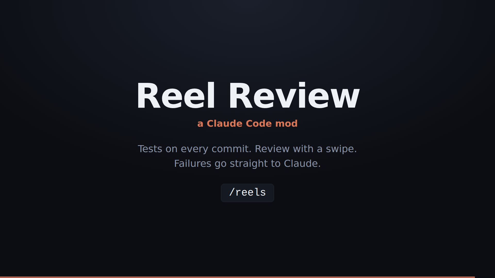
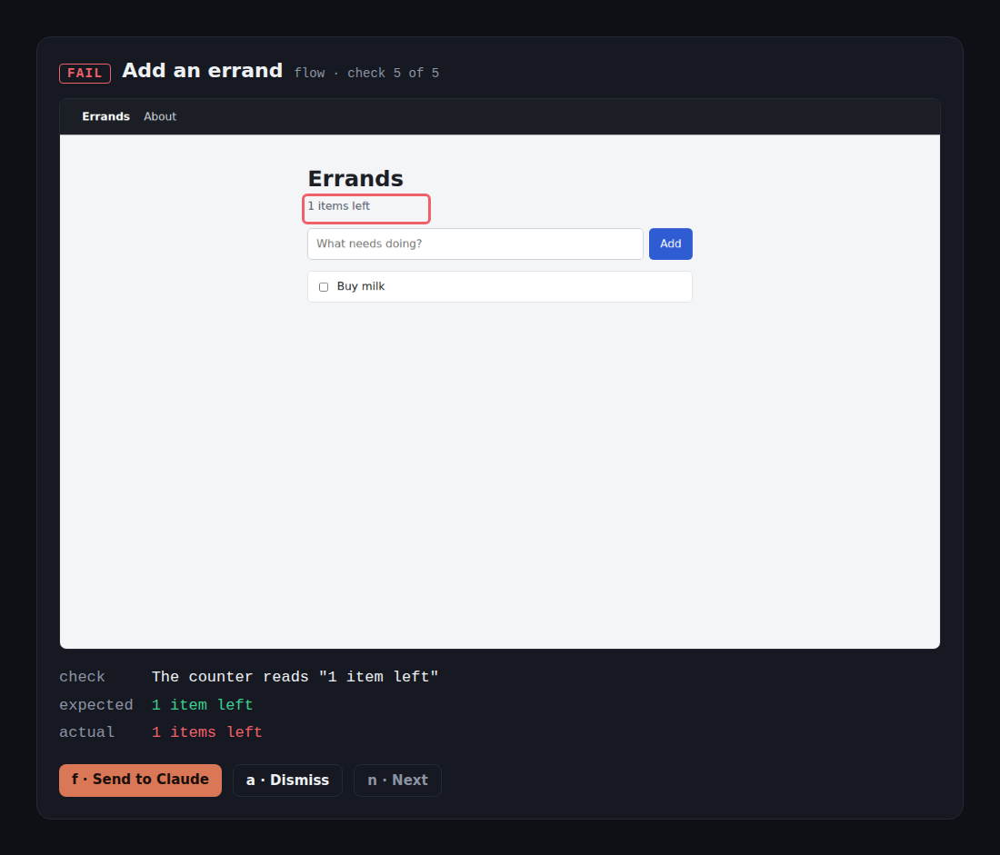

# Reel Review

**A Claude Code mod that tests your app after every commit, then lets you review the results with a swipe.**



When Claude makes a commit, Reel Review clicks through your app in a real browser and screenshots every screen. Anything that broke or changed becomes a card in a **Reels** pane inside Claude Code:

- **f** sends the card to Claude. The failing step, expected vs actual and the screenshot path become a prompt in your session, and Claude goes and fixes it.
- **a** approves it. A screen that changed on purpose becomes the new baseline.

Passing checks stay out of your way.

What a card carries, from the example app's planted bug:



## How it works

There are two parts:

| Part | What it is |
|---|---|
| `plugin/` | The Claude Code mod. It adds `/reels` and the Reels pane, and re-runs the reels after each successful `git commit` in your session. |
| `runner/` | A small Playwright runner. It runs your **flows** (click-throughs with checks), shoots your **screens**, diffs them against the approved baseline, and writes `.reels/cards.json`. |

No AI runs during a test. The runner is plain browser automation, so a run costs nothing. Claude only gets involved when you send it a card.

A screen card is raised when:

- the page threw a JavaScript error,
- your app answered a request with a 5xx,
- the page rendered blank, or
- more than 0.05% of its pixels differ from the baseline.

A flow card is raised when a step throws or a check fails. Each card shows the step that failed, expected vs actual, and the screenshot at that moment.

## Try it in two minutes

You need Node 20+ and git.

```bash
git clone https://github.com/59thProfile/reel-review
cd reel-review

# 1. The runner
cd runner
npm install
npx playwright install chromium

# 2. Start the example app (in another terminal, from the repo root)
node example/server.mjs

# 3. First run: everything passes and becomes the baseline
node reel.mjs run
# reels: 0 failing, 0 changed, 6 passing
```

Now plant a bug and run again:

```bash
# stop the example app, then
BUG=1 node example/server.mjs      # PowerShell: $env:BUG='1'; node example/server.mjs

node reel.mjs run
# reels: 2 failing, 0 changed, 4 passing
```

Both "1 items left" cards are waiting in `.reels/cards.json`.

## Install the mod

The mod uses Claude Code's plugin hooks modules. It was built and tested on Claude Code 2.1.287.

**From a terminal**, for one session:

```bash
claude --plugin-dir /path/to/reel-review/plugin
```

**In the desktop app**, or to load it every time, add the folder to `~/.claude/settings.json`, along with where the runner is:

```json
{
  "env": {
    "CLAUDE_CODE_PLUGIN_DIRS": "/path/to/reel-review/plugin"
  },
  "pluginConfigs": {
    "reel-review": {
      "options": {
        "pipelineDir": "/path/to/reel-review/runner",
        "runOnCommit": true
      }
    }
  }
}
```

On Windows use forward slashes (`C:/Users/you/reel-review/plugin`). The mod loads when a session starts, so open a **new** session after changing settings.

You can also set the runner folder from `/config` → **reel-review** → **Reel runner folder**.

## Use it on your own app

Edit `runner/reels.config.mjs`:

```js
export default {
  app: 'My app',
  baseURL: 'http://localhost:3000',

  // Optional: sign in once before the screens are shot.
  async setup(page) { /* page.goto('/login') … */ },

  screens: [
    { id: 'home', name: 'Home', path: '/' },
    { id: 'settings', name: 'Settings', path: '/settings', mask: ['.last-seen'] },
  ],

  flows: [
    {
      id: 'signup',
      title: 'New user can sign up',
      intent: 'A visitor creates an account and lands on their dashboard.',
      async run(t) {
        await t.step('Open sign-up', (p) => p.goto('/signup'));
        await t.step('Fill the form', async (p) => { /* … */ }, (p) => p.locator('form'));
        await t.expect('Lands on /dashboard', (p) => {
          const at = new URL(p.url()).pathname;
          return { ok: at === '/dashboard', expected: '/dashboard', actual: at };
        });
      },
    },
  ],
};
```

- `t.step(label, action, target?)` is an action. If it throws, the flow stops there.
- `t.expect(label, check, target?)` is a check. Return `{ ok, expected, actual }`, and the card shows both values.
- `target` names the element the step is about, so the card can point at it.
- `mask` hides parts of a screen that change on every run, such as clocks and avatars.
- `REEL_BASE_URL` overrides `baseURL`. `REEL_CHROMIUM` points at a Chromium binary if you don't want Playwright's own.

Your app has to be running when the reels run. The runner says so plainly if nothing answers.

## Using the pane

| Key | Does |
|---|---|
| `f` | Send to Claude |
| `a` | Approve the screen as the new baseline, or dismiss a flow card |
| `n` / `p` | Next / previous card |
| `r` | Re-run now |

`/reels` opens the pane. `/reels run` re-runs everything. In a terminal that speaks the kitty graphics protocol (Ghostty, kitty), the card shows the screenshot or pixel diff inline. Elsewhere it shows the file path.

## Runner commands

```bash
node reel.mjs run              # run flows + screens, write .reels/cards.json
node reel.mjs approve <id>     # accept a screen's latest shot as its baseline
```

Everything is written to `runner/.reels/`. Commit `runner/.reels/baseline/` if you want your team to share the approved look. Ignore the rest.

## Limits

- A change smaller than the noise threshold (0.05% of the screen, about one short word) does not raise a screen card. Use a flow check for text that matters. In the example, the flows catch the "1 items left" bug and the screen diff does not.
- Screens are shot at one viewport (1280×800 by default, set `viewport` to change it).
- Runs take as long as your flows do. The example takes about 10 seconds.

## License

MIT
